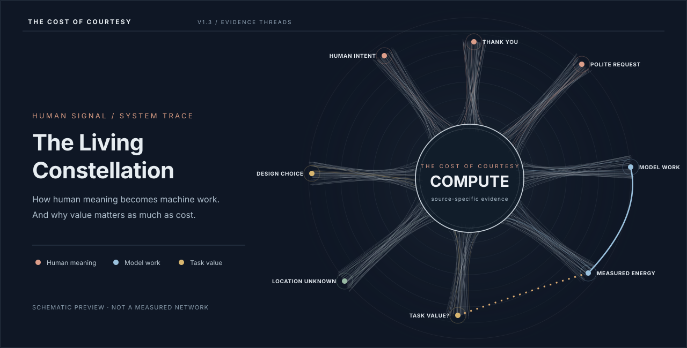

# The Cost of Courtesy

### The Living Constellation · Interactive research experience · V1.4

**What does it cost when we say “thank you” to AI—and is that the right question?**

A six-act, evidence-linked investigation into how everyday human communication becomes machine work, how that work relates to useful outcomes, and why its environmental consequences are harder to measure than a token count suggests.

**[Explore the interactive experience](https://chrisdhayes.github.io/the-cost-of-courtesy/)** · [Full research essay](research/THE_COST_OF_COURTESY_RESEARCH_ESSAY.md) · [Substack draft](publication/SUBSTACK_ARTICLE_DRAFT.md) · [Methods](methods/METHODS.md) · [Sources & attribution](LICENSE_AND_ATTRIBUTION.md) · [V1.4 notes](RELEASE_NOTES_V1_4.md)

> **The argument:** The cost of a conversation is not determined by the words alone. It depends on how systems interpret them, the work they perform, the value they create and the resources they consume.

*Illustrative schematic of the interactive Courtesy Constellation (not a screenshot). Select the preview to open the full experience. The fine radial filaments are an artistic structural motif—not individual data records, statistical distances or measured causal links.*

## Why this exists

A short acknowledgment can trigger a new model response. Politeness inside a substantive request, however, can influence the length and usefulness of the answer in ways that differ across models and tasks. And a model's energy consumption is not automatically a measure of its water footprint or of a completed task's value.

The project puts these otherwise separate findings in conversation with one another **without treating them as a single experiment**. It is a secondary synthesis of published research, not an original trial or a universal estimate of ChatGPT's environmental impact.

## Follow the story

**Select an act to open that chapter in the interactive experience.**

| Act — open in the experience | Question |
| --- | --- |
| **[01 — Two words](https://chrisdhayes.github.io/the-cost-of-courtesy/#act-1)** | What happens when a thank-you generates another response? |
| **[02 — The contradiction](https://chrisdhayes.github.io/the-cost-of-courtesy/#act-2)** | Why might courtesy add work in one setting but affect output length in another? |
| **[03 — The value question](https://chrisdhayes.github.io/the-cost-of-courtesy/#act-3)** | Is the shortest answer necessarily the most useful or efficient? |
| **[04 — The language divide](https://chrisdhayes.github.io/the-cost-of-courtesy/#act-4)** | Why can model efficiency and evaluation results vary across languages? |
| **[05 — The physical footprint](https://chrisdhayes.github.io/the-cost-of-courtesy/#act-5)** | Where do electricity and water impacts actually arise? |
| **[06 — The design choice](https://chrisdhayes.github.io/the-cost-of-courtesy/#act-6)** | What should responsible AI systems do differently? |

The chapter links point to anchors in the current V1.4 `index.html`. They work once GitHub Pages has successfully deployed.

Use **Guided Story** to follow 15 scroll-driven evidence checkpoints, **Explore** to inspect the full radial Constellation and supporting instruments, and **Evidence & Methods** to examine measurement boundaries and limitations. Source-linked evidence receipts explain what is measured, derived, inferred or still unknown.

### Four linked visual instruments

- **The Courtesy Constellation:** an eight-node conceptual network with nine typed research relationships. Relationship styles distinguish within-study evidence, interpretation, evidence gaps and design proposals.
- **Resolution Signal Plate:** published hardware energy components, explicitly *modelled* GPU sensitivity scenarios and PromptTone output-length comparisons, shown in their own units.
- **[The Median Isn't Neutral — Act 4](https://chrisdhayes.github.io/the-cost-of-courtesy/#language-distribution):** all 122 published source language records, arithmetic mean/median and IQR, distance-from-median and synchronized cost/accuracy distributions. The original 12 highlighted languages remain available for closer evaluation scrutiny. [Inspect the attributed 122-row data extract](data/language122_qwen3_8b_belebele.json).
- **Geography of a Thank You:** environmental accounting context without inventing the route, serving region or data centre used by any individual request.

## Evidence and scientific boundaries

| Source | What it supports | Important boundary |
| --- | --- | --- |
| [Delavande, Pierrard & Luccioni (2026), *Small Talk, Big Impact*](https://arxiv.org/abs/2601.22357) | Reported **0.245 Wh** average total hardware energy per generated thank-you response in a specific Llama 3.1–8B / H100 setup | Not a universal ChatGPT figure; GPU/CPU measured and RAM estimated using the study's method |
| [Andruccioli et al. (2026), *PromptTone*](https://doi.org/10.3390/data11040088) | Model-dependent differences in mean *generated code characters* under different prompt tones | Characters are not tokens, electricity or proven task completion |
| [Deng et al. (2026), *The Language–Energy Divide*](https://aclanthology.org/2026.emnlp-main.2113/) | Language-dependent energy and evaluation outcomes, including strict versus lenient accuracy | Not a test isolating politeness; the new instrument shows all 122 canonical language rows, with 12 highlighted for guided interpretation |
| [Elsworth et al. (2025), Google-scale inference measurement](https://arxiv.org/abs/2508.15734) | Published production energy and cooling-water estimates | Not measurements of the thank-you experiment; the numbers must not be fused |
| [WRI Aqueduct 4.0](https://www.wri.org/data/aqueduct-global-maps-40-data) | Environmental water-stress context | No request-level infrastructure location or site-specific water burden is claimed |

The project uses **reported/measured → derived/modelled → interpreted → unknown/hypothesis** labels. The [methods and evidence contract](methods/METHODS.md) documents the nine typed relationships, full 122-language distribution methodology and explains why the radial filaments are not individual observations. Primary sources, data reuse conditions and attribution are summarized in [LICENSE_AND_ATTRIBUTION.md](LICENSE_AND_ATTRIBUTION.md).

**What this experience does not claim:** a single causal effect of politeness on AI energy; verified energy per successfully resolved task; real-world routing of a user's prompt; universal national or cultural rankings; or independently replicated raw results for all cited studies.

## Read the research and reuse the experience

- **[Full research essay](research/THE_COST_OF_COURTESY_RESEARCH_ESSAY.md)** — the central argument, evidence review, proposed decision frameworks, limitations and primary references.
- **[Shorter Substack article draft](publication/SUBSTACK_ARTICLE_DRAFT.md)** — an engaging, personal introduction with links to all six acts; a draft, not a published Substack post.
- **[Methods and evidence contract](methods/METHODS.md)** — study boundaries, calculations, uncertainty and relationship semantics.
- **[Sources, licensing and attribution](LICENSE_AND_ATTRIBUTION.md)** — provenance and conditions for third-party material.
- **[V1.4 release notes](RELEASE_NOTES_V1_4.md)** — the integrated 122-language analysis, without removing the V1.3 instruments.
- **[V1.3 release notes](RELEASE_NOTES_V1_3.md)** — the approved Evidence Threads baseline, archived under [releases/v1.3](releases/v1.3/index.html).

### Open the experience

- **Online:** [Launch the six-act experience](https://chrisdhayes.github.io/the-cost-of-courtesy/) when GitHub Pages reports a successful deployment.
- **Offline:** Download `index.html` from this repository and open it in a modern browser. The deployed `index.html` is **self-contained**, with embedded styles, scripts and the necessary data extracts.
- **Source organization:** the underlying modular release also contains separated JavaScript, CSS and datasets; the current GitHub Pages entry point does **not** require those external files.

The [preview](previews/courtesy_constellation_schematic.svg) is an **illustrative schematic**, not a screenshot or underlying dataset.

## Reuse, licenses and attribution

**Research synthesis and original visual design:** Christopher Hayes, CDAIO · 2026.

This repository mixes original writing/code with **third-party research excerpts that may have different licenses**. In particular, selected MichiganNLP rows are adapted from [CC BY-SA 4.0](https://creativecommons.org/licenses/by-sa/4.0/) data and must retain attribution and applicable ShareAlike conditions. PromptTone is cited with the paper's identified CC BY 4.0 dataset license; no full third-party PromptTone dataset is redistributed. The independently hosted thank-you measurement records are not redistributed here while their separate reuse terms remain unresolved. See [LICENSE_AND_ATTRIBUTION.md](LICENSE_AND_ATTRIBUTION.md) before reusing or redistributing any component. No blanket open-source license for all repository contents is implied.

## Browser and mobile QA

**V1.4 verification: 192 of 192 automated checks passed** across Chromium desktop/tablet/mobile viewports (including 320px), WebKit mobile emulation and Firefox desktop. The public GitHub Pages URL also returned HTTP 200 with the integrated Act 4 language exhibit. The 320px Guided/Explore navigation and mobile chart swipe affordances were corrected during testing. See the [QA report](qa/QA_REPORT_V1_4.md), [reproducible browser tests](qa/browser_qa.mjs), and [GitHub Actions results](https://github.com/ChrisDHayes/the-cost-of-courtesy/actions/runs/43005103583).

**Limits:** this is not physical-device or formal WCAG certification; see the documented scope and outstanding checks.

## Quality and publication status

V1.4 is a **research-led interactive release candidate**, extending the archived V1.3 baseline with a full-cohort language instrument. V1.3's 15 checkpoint structure and visual evidence relationships remain intact. Its 15 checkpoints and evidence-link controls were tested in four Chromium viewport emulations, including keyboard selection and return from Explore mode. The verification scope and important limitations are summarized in the [research methods](methods/METHODS.md) and [V1.3 release notes](RELEASE_NOTES_V1_3.md).

Not yet certified: full WCAG conformance, Safari/Firefox, physical-device field testing, an independent academic review or complete replication of all underlying raw datasets.

## About the project

Created by **Christopher Hayes, CDAIO** as an exploration of applied data science, evidence synthesis, data visualization, human-centred information design and responsible Data & AI leadership. Wealth management appears as a secondary applied example; the central research question extends across industries.

**The question worth keeping:** Should people have to change how they communicate to make AI more efficient—or should we design systems that understand human communication while using computation more responsibly?